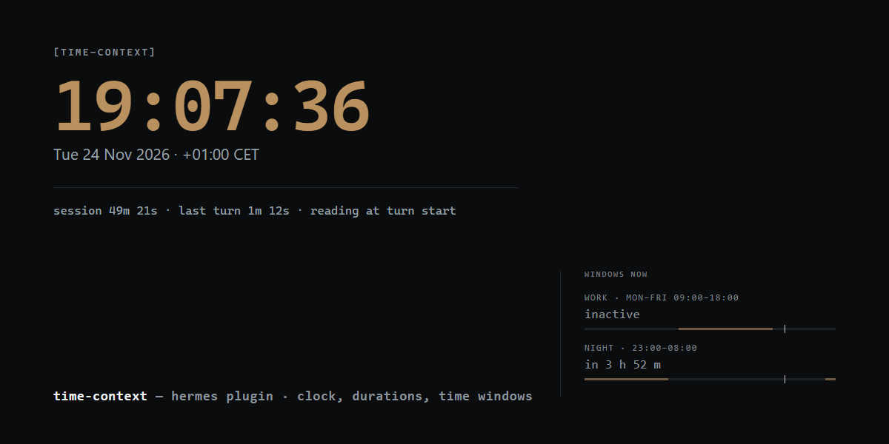
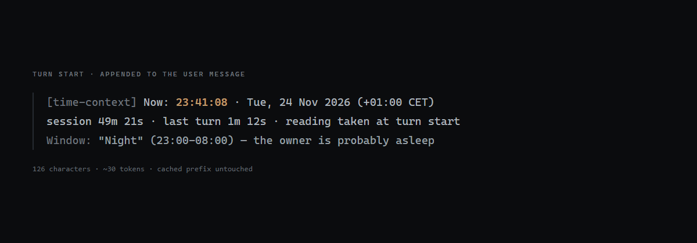
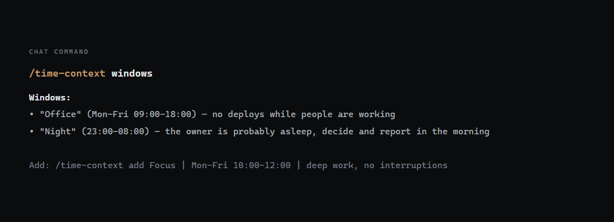

<div align="center">



# time-context

**Your agent always knows what time it is.**

[](LICENSE)
[](CHANGELOG.md)
[](https://github.com/trappka/hermes-time-context/actions/workflows/ci.yml)
[](https://hermes-agent.nousresearch.com)
[](#development)

</div>

Hermes stamps the **session start** into the system prompt and nothing else. Ask an agent
"is it a good moment to deploy?" at 22:40 and it has no idea — it guesses, or it spends a
tool call on `date`. This plugin puts a one-line, always-fresh clock reading into every turn,
together with the two durations a model cannot feel on its own: how long the session has been
running and how long the previous turn actually took.

And it can say more than "22:40": you give it named **time windows** — office hours, night,
quiet hours, a maintenance slot — and the agent sees which of them is active *and what you
wanted it to do inside them*.



## Why the user message and not the system prompt

A `time.md` pasted into the system prompt has two problems: it freezes at session start and it
**breaks the prompt cache** — the system prompt is meant to be byte-stable across a session, so
a changing line there makes the provider rewrite the whole prefix every turn. On a long session
that is the difference between paying for one prompt and paying for it forty times.

Hermes has a purpose-built slot for per-turn text: `pre_llm_call` returns `{"context": ...}` and
the host appends it to the **current user message** at API time (`agent/turn_context.py`),
leaving the system prompt and every earlier message byte-identical. The reading rides the tail,
so it is cache-safe by construction and refreshed every turn.

## What you get

| Surface | What it does |
|---|---|
| turn context | one line: date, weekday, clock time, UTC offset, session age, previous turn length |
| active windows | every configured window that is active now, with the note you attached to it |
| `now` tool | exact reading on demand: ISO time, epoch, weekday, durations, active windows |
| `/time-context` | inspect the block; `add` / `remove` / `windows` to manage windows from chat |

## Install

```bash
hermes plugins install trappka/hermes-time-context --enable
hermes config set plugins.entries.time-context.settings.locale en
hermes config set plugins.entries.time-context.settings.timezone Europe/Berlin
```

Or drop the directory into `~/.hermes/plugins/time-context/` and restart Hermes.

Requires Hermes Agent `>=0.21.5`. No third-party dependencies — standard library only.

## Windows: the part that changes behaviour

A clock is data. Decisions are made on **intervals**. Windows let you describe your own schedule
and attach the rule the agent should follow inside it. Nothing about work, night or rest is
hardcoded: a new project or a new timetable is a new entry, not a code change.

```yaml
plugins:
  entries:
    time-context:
      settings:
        locale: en
        timezone: Europe/Berlin
        windows:
          - name: Office hours
            when: "Mon-Fri 09:00-18:00"
            note: "people are working: no deploys and no long builds until it is quiet"
          - name: Night
            when: "23:00-08:00"
            note: "the owner is probably asleep: decide, don't ask, report in the morning"
          - name: Maintenance
            when: "sun 02:00-05:00"
            note: "the only slot where a restart is allowed"
```

`when` accepts `Mon-Fri` / `пн-пт` / `sat,sun` / `daily` / `0-4`, English or Russian day names,
and one time range. A range that wraps midnight (`23:00-08:00`) belongs to the day it starts on,
so it covers the early morning. Malformed entries are skipped, never fatal.

Manage them from chat:

```
/time-context
/time-context windows
/time-context add Focus | Mon-Fri 10:00-12:00 | deep work, no interruptions
/time-context remove Focus
```



## Settings

Everything below is declared in `plugin.yaml` under `config_schema` and rendered as a form in
Hermes Desktop and the dashboard.

| Key | Type | Default | Meaning |
|---|---|---|---|
| `enabled` | bool | `true` | Inject the block at turn start |
| `locale` | `en` / `ru` | `en` | Language of the block and of the chat command |
| `timezone` | str | machine zone | IANA zone, e.g. `Europe/Berlin`; empty = local |
| `show_seconds` | bool | `true` | Seconds in the clock reading |
| `show_durations` | bool | `true` | Session age and previous turn length |
| `show_stamp_note` | bool | `true` | "reading taken at turn start" hint |
| `windows` | list | `[]` | Named intervals with notes (JSON in the form) |

Settings are read on every turn, so a change applies on the next one — no restart.

## Cost and limits

- ~30 tokens per turn, in the uncached tail of the message.
- The `now` tool adds its schema once per session.
- In exchange the agent stops spending tool calls on `date` to answer "can I do this now?".
- The block is capped in tests under 300 characters, so it cannot quietly grow into a preamble.

What it deliberately does **not** do:

- does not touch the system prompt (cache safety);
- does not rewrite history or tool results;
- does not block actions — time is information, not a gate. Use a `pre_tool_call` policy when you
  need a hard stop;
- does not reach the network. It reports the machine clock and says so (`clock_source: system`);
  if the host clock drifts, so does the reading.

## Development

```bash
python tests/test_time_context.py
python tests/test_command.py
hermes plugins validate .
```

CI runs the same two suites on Python 3.10–3.13 and re-runs the plugin validator on every push.

## License

MIT — see [LICENSE](LICENSE).
